# Wazuh SIEM Endpoint Configuration & Security Monitoring: OVA Deployment, Real-Time FIM (`whodata`) & PCI-DSS / GDPR Compliance Auditing


> **Executive Summary:** This project documents the end-to-end deployment and operational configuration of the **Wazuh Open Source Security Platform (`v4.14.1`)** for centralized endpoint telemetry, real-time **File Integrity Monitoring (FIM)**, and automated regulatory compliance auditing (**PCI DSS** & **GDPR**). Deployed as a virtualized SIEM manager in Oracle VirtualBox (`wazuh-server`) monitoring a **Windows 11 Enterprise** endpoint (`windows-vm`, Agent `001`), the implementation resolves control-plane API daemon initialization issues, automates headless agent enrollment via PowerShell, enforces real-time `whodata` audit policies under `<syscheck>`, and correlates filesystem tampering (`Rule IDs 550, 553, 554`) and **CIS Microsoft Windows 11 Enterprise Benchmark v3.0.0** checks (`Rule ID 19009`) directly to **PCI DSS (`11.5`, `2.2`)** and **GDPR (`II_5.1.f`, `IV_35.7.d`)** mandates.

| Field | Detail |
| :--- | :--- |
| **Project Title** | Wazuh Endpoint Configuration And Security Monitoring |
| **Security Analyst / Engineer** | Chinaza Nnamani |
| **SIEM Platform & Version** | Wazuh Open Source Security Platform `v4.14.1` OVA (`wazuh-server`) |
| **Monitored Endpoint (`Agent 001`)** | `windows-vm` — Microsoft Windows 11 Enterprise Evaluation (`10.0.26100.6899`) |
| **Network Topology** | Bridged LAN (`192.168.0.0/24`) — Manager: `192.168.0.5` / `192.168.0.7` \| Agent: `192.168.0.6` |
| **Core Capabilities Validated** | Agent Enrollment, Real-Time FIM (`syscheck` + `whodata`), CIS SCA, PCI DSS & GDPR Compliance |

---

## Table of Contents
- [Tools Used](#tools-used)
- [Skills Learned](#skills-learned)
- [1. Problem Statement & Objectives](#1-problem-statement--objectives)
- [2. Architecture & Design Overview](#2-architecture--design-overview)
- [3. Technology Stack & Tooling](#3-technology-stack--tooling)
- [4. Full Documentation Index](#4-full-documentation-index)
- [5. Implementation Walkthrough](#5-implementation-walkthrough)
  - [Phase 1: Wazuh Manager VM Setup & API Daemon Troubleshooting](#phase-1-wazuh-manager-vm-setup--api-daemon-troubleshooting)
  - [Phase 2: Automated Agent Enrollment on the Windows 11 Endpoint](#phase-2-automated-agent-enrollment-on-the-windows-11-endpoint)
  - [Phase 3: Policy Configuration — Real-Time File Integrity Monitoring (FIM)](#phase-3-policy-configuration--real-time-file-integrity-monitoring-fim)
  - [Phase 4: Regulatory Compliance Auditing (PCI DSS & GDPR)](#phase-4-regulatory-compliance-auditing-pci-dss--gdpr)
- [6. Validation, Testing & Proof of Work](#6-validation-testing--proof-of-work)
- [7. Key Challenges & Trade-Offs](#7-key-challenges--trade-offs)
- [8. Future Enhancements](#8-future-enhancements)
- [Author & Contact](#author--contact)

---

## Tools Used

**SIEM, XDR & Compliance Platform**  


-005571?style=for-the-badge&logo=elastic&logoColor=white)

**Virtualization & Operating Systems**  


-FCC624?style=for-the-badge&logo=linux&logoColor=black)

**Scripting, Configuration & Benchmarks**  


---

## Skills Learned

**SIEM Architecture & Endpoint Engineering**  


-Endpoint_Security-orange?style=flat-square)

**Security Operations, Threat Detection & Compliance**  

-Hardening-2088FF?style=flat-square)


---

## 1. Problem Statement & Objectives

### Background & Risk / Bottleneck
Unauthorized creation, modification, or deletion of sensitive files and configuration registries on enterprise endpoints is a primary indicator of ransomware execution, credential harvesting, and insider tampering. Without centralized **File Integrity Monitoring (FIM)** operating in real-time `whodata` mode, security teams cannot detect when critical files are altered or deleted until after an incident escalates. Additionally, organizations subject to **PCI DSS** (Payment Card Industry Data Security Standard) and **GDPR** (General Data Protection Regulation) face severe audit bottlenecks when trying to manually correlate low-level endpoint telemetry and **CIS Benchmark** configuration checks to specific regulatory clauses (such as **PCI DSS Requirement 11.5** for change-detection mechanisms or **GDPR Article 5(1)(f)** for data integrity and confidentiality).

### Core Objectives
* **Objective 1 (Wazuh SIEM Control-Plane Deployment & API Recovery):** Provision the **Wazuh v4.14.1 OVA** appliance in Oracle VirtualBox (`4096 MB` RAM, `2` vCPUs, Bridged Networking), diagnose and resolve initial boot-time `wazuh-manager` API connection failures (`Port 55000`), and establish web dashboard access.
* **Objective 2 (Automated Windows 11 Endpoint Enrollment):** Deploy and enroll a **Windows 11 Enterprise** virtual machine (`windows-vm`, IP `192.168.0.6`) into the Wazuh cluster (`node01`) as `Agent 001` using an automated PowerShell MSI installation pipeline.
* **Objective 3 (Real-Time File Integrity Monitoring with `whodata`):** Configure the `<syscheck>` engine on the Windows endpoint (`C:\Program Files (x86)\ossec-agent\ossec.conf`) with `check_all="yes"`, `realtime="yes"`, and `whodata="yes"` on targeted sensitive paths (`C:\Users\windows\Desktop\mon_dir\No_Man.txt` and `C:\Users\windows\Desktop\razor`), and validate detection across file creation (`Rule 554`), modification (`Rule 550`), and deletion (`Rule 553`).
* **Objective 4 (Automated PCI DSS & GDPR Regulatory Auditing):** Leverage Wazuh's built-in compliance mapping and Dashboard Query Language (`DQL`) filters (`rule.pci_dss: *` and `rule.gdpr: *`) to audit **556 PCI DSS** and **564 GDPR** events across FIM alerts and **CIS Microsoft Windows 11 Enterprise Benchmark v3.0.0** assessments.

> [!IMPORTANT]
> **Scope Note:** This `README.md` is a complete, self-contained technical case study and operational runbook. It consolidates the full virtual appliance setup, daemon troubleshooting, agent enrollment scripts, XML policy configurations, FIM validation proofs, and compliance mapping in a single file.

---

## 2. Architecture & Design Overview

### System Workflow & Telemetry Pipeline (Mermaid Diagram)

```mermaid
graph LR
    subgraph Win11_Endpoint ["Monitored Endpoint: Windows 11 Enterprise (windows-vm | 192.168.0.6)"]
        direction TB
        FS["📁 Monitored Paths:<br/>1. C:\Users\windows\Desktop\mon_dir\No_Man.txt<br/>2. C:\Users\windows\Desktop\razor<br/>3. System32 & Registry (6,885 items)"]
        SAC["🛡️ Windows Audit / SACL Engine<br/>(Real-Time 'whodata' Tracking)"]
        SCA["📋 CIS Windows 11 Enterprise<br/>Benchmark v3.0.0 Scanner (SCA)"]
        AGENT["⚙️ Wazuh Agent v4.14.1 (ID: 001)<br/>Config: C:\Program Files (x86)\ossec-agent\ossec.conf<br/>Service: NET START Wazuh"]

        FS -->|"Add / Modify / Delete"| SAC
        SAC -->|"Real-Time Syscheck Events"| AGENT
        SCA -->|"Configuration Audit Results"| AGENT
    end

    subgraph Wazuh_SIEM ["Wazuh Server OVA v4.14.1 (wazuh-server | 192.168.0.5 / 192.168.0.7)"]
        direction TB
        MGR["🔥 Wazuh Manager Daemon<br/>(syscheck & sca Decoders)<br/>Rules: 550 (Mod), 553 (Del), 554 (Add), 19009 (CIS)"]
        API["🔌 Wazuh Server API<br/>[https://127.0.0.1:55000](https://127.0.0.1:55000)<br/>User: wazuh-wui (Status: Online)"]
        FB["🔐 Filebeat (SSL/TLS)<br/>Cert: /etc/filebeat/certs/wazuh-server.pem"]
        IDX[("🗄️ Wazuh Indexer<br/>[https://127.0.0.1:9200](https://127.0.0.1:9200)<br/>Index: wazuh-alerts-4.x-2025.12.31")]
        DASH["📊 Wazuh Web Dashboard (HTTPS :443)<br/>- FIM Events & Inventory<br/>- PCI DSS (556 hits: Req 11.5, 2.2)<br/>- GDPR (564 hits: II_5.1.f, IV_35.7.d)"]

        MGR --> FB
        MGR <--> API
        FB --> IDX
        API --> DASH
        IDX --> DASH
    end

    AGENT ==>|"Encrypted Telemetry<br/>(TCP 1514 / Enrollment 1515)"| MGR
```



### Key Design Decisions
1. **Endpoint-Side `<syscheck>` Configuration (`C:\Program Files (x86)\ossec-agent\ossec.conf`):** A critical architectural distinction in Wazuh is that `/var/ossec/etc/ossec.conf` on the Wazuh Manager only governs the manager's own local filesystem, not remote agents. Configuring the Windows directories directly inside the Windows agent's `ossec.conf` (and restarting the local `wazuh` service) ensured that endpoint filesystem changes were actively monitored and transmitted to the manager.
2. **Enabling `whodata="yes"` and `realtime="yes"` Over Scheduled Scans:** By default, Wazuh `<syscheck>` runs periodic scans every 12 hours (`<frequency>43200</frequency>`), which creates a blind spot if an attacker creates and deletes a staging file between scan intervals. Enabling `realtime="yes"` and `whodata="yes"` hooks directly into the Windows Security Auditing subsystem, capturing instantaneous file creation, modification, and deletion events along with the acting user/process context.
3. **Automated Regulatory Tagging (`PCI DSS` & `GDPR`):** Rather than maintaining separate compliance tools, Wazuh's rule definitions automatically enrich every FIM alert (`550`, `553`, `554`) and CIS Benchmark finding (`19009`) with `rule.pci_dss` and `rule.gdpr` metadata fields, enabling instant DQL filtering (`rule.pci_dss: *` and `rule.gdpr: *`) for audit reporting.

---

## 3. Technology Stack & Tooling

### Lab Environment & Asset Inventory

| Component / Role | Hostname / Identifier | Operating System / Version | IPv4 Address | Hardware / Specs | Key Configuration Details |
| :--- | :--- | :--- | :--- | :--- | :--- |
| **Wazuh SIEM Server** | `wazuh-server` | Wazuh `v4.14.1` OVA (Linux 64-bit) | `192.168.0.5` -> `192.168.0.7` | 4096 MB RAM, 2 vCPUs, Bridged NIC (`08:00:27:b9:d0:75`) | CLI: `wazuh-user` \| Web UI: `admin` \| API: `https://127.0.0.1:55000` \| Indexer: `9200` |
| **Monitored Endpoint** | `windows-vm` (Agent ID: `001`) | Microsoft Windows 11 Enterprise Eval (`10.0.26100.6899`) | `192.168.0.6` | 2 vCPUs, TPM 2.0, EFI, Secure Boot, 48.50 GB SATA, Bridged NIC | Wazuh Agent `v4.14.1` \| Group: `default` \| Node: `node01` |

### Security Modules, Rules & Compliance Matrix

| Module / Feature | Rule IDs / Filters | Severity Level | Regulatory Mapping | Operational Function in This Project |
| :--- | :--- | :--- | :--- | :--- |
| **FIM — File Added** | `Rule ID: 554` (`syscheck`) | Level `5` | `PCI DSS 11.5`, `GDPR II_5.1.f` | Triggers when a new file (`test.txt`, `new text document.txt`) is created in a monitored directory |
| **FIM — File Modified** | `Rule ID: 550` (`syscheck`) | Level `7` | `PCI DSS 11.5`, `GDPR II_5.1.f` | Triggers when a monitored file's cryptographic checksum changes (`No_Man.txt`, `test.txt`) |
| **FIM — File Deleted** | `Rule ID: 553` (`syscheck_deleted`) | Level `7` | `PCI DSS 11.5`, `GDPR II_5.1.f` | Triggers in `whodata` mode when a monitored file is deleted from disk |
| **CIS Benchmark (SCA)** | `Rule ID: 19009` (`sca`) | Level `3` | `PCI DSS 2.2`, `GDPR IV_35.7.d` | Evaluates Windows 11 against the `CIS Microsoft Windows 11 Enterprise Benchmark v3.0.0` |

---

## 4. Full Documentation Index

All architectural diagrams, CLI/PowerShell commands, XML configuration blocks, troubleshooting steps, and compliance evidence are self-contained within this `README.md`:

```text
wazuh-endpoint-configuration-and-security-monitoring/
├── assets/
│   └── images/                      # 27 step-by-step VirtualBox, Wazuh CLI/Dashboard, and Windows 11 screenshots
├── Wazuh_assessment.pdf             # Original 27-page Wazuh Endpoint Configuration & Monitoring Report
└── README.md                        # Complete Self-Contained SIEM Case Study & Operational Runbook
```

| Section Link | Description |
| :--- | :--- |
| [**Phase 1: Wazuh Manager Setup & API Fix**](#phase-1-wazuh-manager-vm-setup--api-daemon-troubleshooting) | Steps 1–8: Importing Wazuh `v4.14.1` OVA, identifying IP via `ifconfig`, diagnosing the offline API (`Port 55000`), and starting `wazuh-manager`. |
| [**Phase 2: Windows 11 Agent Enrollment**](#phase-2-automated-agent-enrollment-on-the-windows-11-endpoint) | Steps 1–5: Configuring agent parameters in the Web UI, executing the PowerShell MSI deployment command, and verifying `Active` status (`ID: 001`). |
| [**Phase 3: File Integrity Monitoring (FIM)**](#phase-3-policy-configuration--real-time-file-integrity-monitoring-fim) | Steps 1–10: Troubleshooting manager vs. agent `ossec.conf` scope, enabling `whodata="yes"` on Windows 11, and capturing `Rule 550/553/554` events. |
| [**Phase 4: PCI DSS & GDPR Compliance**](#phase-4-regulatory-compliance-auditing-pci-dss--gdpr) | Auditing `556` PCI DSS hits (`rule.pci_dss: *`) and `564` GDPR hits (`rule.gdpr: *`) across FIM and CIS Benchmark controls. |

---

## 5. Implementation Walkthrough

### Phase 1: Wazuh Manager VM Setup & API Daemon Troubleshooting

1. **Import and Provision the Wazuh OVA in VirtualBox:** Downloaded the **Wazuh `v4.14.1` OVA** appliance and imported it into Oracle VirtualBox Manager. Provisioned the virtual machine with **`4096 MB` of Base Memory**, **`2` Processors**, **`Nested Paging / KVM Paravirtualization`**, and **`Adapter 1`** attached to **`Bridged Adapter`** (`Intel(R) Dual Band Wireless-AC 8260`) to ensure stable performance and direct LAN reachability.

2. **Boot the Wazuh Server & Authenticate via CLI:** Started the Wazuh virtual machine (`wazuh-server`) and logged into the terminal console using the default OVA credentials (`User: wazuh-user` / `Password: wazuh`).

3. **Identify the Wazuh Manager IP Address (`ifconfig`):** Executed `ifconfig` inside the manager CLI to retrieve the IPv4 address assigned to `eth0` (`inet 192.168.0.5`, netmask `255.255.255.0`, MAC `08:00:27:b9:d0:75`; later updated via DHCP to `192.168.0.7`), which is required for accessing the web dashboard and enrolling endpoints.

4. **Start the Windows 11 Endpoint VM & Log In to the Wazuh Web Dashboard:** Powered on the **`windows 11`** virtual machine in VirtualBox (configured on the same Bridged Adapter), opened Google Chrome, navigated to the Wazuh Web Dashboard (`https://192.168.0.5/app/login?`), and signed in as `admin`.

5. **Diagnose & Resolve the `Offline` Server API Error (Steps 6–8):**
   * **Symptom:** Upon logging into the dashboard (`Server APIs -> API Connections`), the interface displayed a warning banner: **`The API connections could be down or inaccessible`**, with the `default` API entry (`Host: https://127.0.0.1`, `Port: 55000`, `Username: wazuh-wui`) showing **`Status: Offline`**.
   * **Root Cause:** Investigation revealed that the `wazuh-manager` background daemons (`wazuh-apid`, `wazuh-analysisd`, `wazuh-remoted`) had failed to initialize completely during the initial OVA boot sequence.
   * **Resolution:** Executed `sudo systemctl start wazuh-manager` in the Wazuh Server CLI to start the manager daemons, then refreshed the browser (`https://192.168.0.7/app/server-apis#/settings?tab=api`), confirming the status transitioned to **`Online`** (`Manager: wazuh-server`, `Version: v4.14.1`, `Updates status: Up to date`).

---

### Phase 2: Automated Agent Enrollment on the Windows 11 Endpoint

1. **Initiate New Agent Deployment in the Wazuh Dashboard:** Navigated to **Endpoints (`Agent Management -> Summary`)** and clicked **`Deploy new agent`**.


2. **Configure Windows Agent Parameters:** In the **Deploy new agent** wizard, configured the following settings to generate the automated installation one-liner:
   * **Operating System Package:** `WINDOWS` -> `MSI 32/64 bits`
   * **Server address:** `192.168.0.7`
   * **Agent name:** `windows-vm`
   * **Group:** `default`

3. **Execute PowerShell Installation & Start the Agent Service:** Opened **Windows PowerShell as Administrator** on the Windows 11 endpoint (`192.168.0.6`), ran the `Invoke-WebRequest` / `msiexec.exe` deployment command, and started the Windows service using `NET START Wazuh`:

```powershell
# 1. Download and silently install the Wazuh Agent MSI, binding it to 192.168.0.7 as 'windows-vm'
Invoke-WebRequest -Uri [https://packages.wazuh.com/4.x/windows/wazuh-agent-4.14.1-1.msi](https://packages.wazuh.com/4.x/windows/wazuh-agent-4.14.1-1.msi) -OutFile $env:tmp\wazuh-agent; msiexec.exe /i $env:tmp\wazuh-agent /q WAZUH_MANAGER='192.168.0.7' WAZUH_AGENT_GROUP='default' WAZUH_AGENT_NAME='windows-vm'

# 2. Start the Wazuh Agent Windows Service
NET START Wazuh
```

4. **Verify Active Agent Connection in the Dashboard:** Returned to the Wazuh Dashboard (`Endpoints` summary) and confirmed that **`windows-vm`** (`ID: 001`, `IP: 192.168.0.6`, `OS: Microsoft Windows 11 Enterprise Evaluation 10.0.26100.6899`, `Cluster node: node01`, `Version: v4.14.1`) was enrolled and reporting **`Status: active`**.

---

### Phase 3: Policy Configuration — Real-Time File Integrity Monitoring (FIM)

1. **Initial Configuration Attempt on the Manager & Root-Cause Discovery (Steps 1–5):**
   * Initially, we opened `/var/ossec/etc/ossec.conf` on the Wazuh Manager VM (`nano /var/ossec/etc/ossec.conf`), added `<directories>` entries under `<syscheck>` for `C:\Users\windows\Desktop\mon_dir\No_Man.txt` and `C:\Users\windows\Desktop\razor`, restarted `wazuh-manager`, and modified `No_Man.txt` on the Windows 11 Desktop.

   * However, checking **File Integrity Monitoring -> Events** in the Wazuh Dashboard returned **`No results match your search criteria`**.


2. **Configuring `ossec.conf` on the Windows 11 Agent & Restarting the Service (Steps 6–7):**
   * **Root Cause & Fix:** Because `/var/ossec/etc/ossec.conf` on the server only configures the manager's local filesystem checks, endpoint-specific directories must be defined in the agent's local configuration file (`C:\Program Files (x86)\ossec-agent\ossec.conf`).
   * Opened `C:\Program Files (x86)\ossec-agent\ossec.conf` on the Windows 11 VM as Administrator and added the two `<directories>` rules inside the `<syscheck>` block with `check_all="yes"`, `realtime="yes"`, and `whodata="yes"`:

```xml
<!-- File integrity monitoring (C:\Program Files (x86)\ossec-agent\ossec.conf) -->
<syscheck>
  <disabled>no</disabled>

  <!-- Frequency that syscheck is executed default every 12 hours -->
  <frequency>43200</frequency>

  <!-- Custom Monitored File and Directory with Real-Time Whodata Auditing -->
  <directories check_all="yes" realtime="yes" whodata="yes">C:\Users\windows\Desktop\mon_dir\No_Man.txt</directories>
  <directories check_all="yes" realtime="yes" whodata="yes">C:\Users\windows\Desktop\razor</directories>
</syscheck>
```

   * Restarted the Wazuh Agent service in Administrator PowerShell to apply the policy:
     ```powershell
     Restart-Service -Name wazuh
     ```


3. **Executing File Tampering Tests on `No_Man.txt` and `razor` (Steps 8–9):**
   * **Test A (`No_Man.txt`):** Opened `C:\Users\windows\Desktop\mon_dir\No_Man.txt`, wrote `"Danger"`, saved the file (triggering an integrity modification), and then deleted `No_Man.txt` from the folder.


   * **Test B (`razor` Directory):** Opened the monitored directory `C:\Users\windows\Desktop\razor`, created a new text file (`New Text Document.txt` -> renamed to `test.txt`), wrote `"Just a test"` inside `test.txt` and saved it, and then deleted `test.txt`.


4. **Verifying Real-Time FIM Alerts & Inventory in the Wazuh Dashboard (Step 10):**
   * Navigated to **File Integrity Monitoring -> Events** in the Wazuh Dashboard. All **7 filesystem events** were captured instantaneously with full `whodata` telemetry (`Rule ID 554` for file additions, `Rule ID 550` for checksum modifications, and `Rule ID 553` for file deletions).
   * Inspected the **Inventory** tab (`Files (10)` and `Windows Registry (6885)`) and drilled into the JSON/Table **Document Details** (`decoder.name: syscheck_deleted`, `Mode: whodata`, `_index: wazuh-alerts-4.x-2025.12.31`).

---

### Phase 4: Regulatory Compliance Auditing (PCI DSS & GDPR)

Wazuh automatically tags security alerts and Security Configuration Assessment (`SCA`) findings with the specific regulatory clauses they impact. We audited the `windows-vm` (`001`) endpoint across both **PCI DSS** and **GDPR** modules and filtered security events using DQL queries:

#### 1. PCI DSS Compliance Monitoring (`rule.pci_dss: *`)
* Navigated to **Security Operations -> PCI DSS** and applied the DQL filter `rule.pci_dss: *` (`556 hits`).
* **Top 5 PCI DSS Requirements Triggered:** `2.2` (Develop configuration standards for all system components), `10.6.1`, `10.2.6`, `11.5` (Deploy a change-detection mechanism / FIM), and `10.2.5`.
* **Event Correlation:**
  * **PCI DSS `11.5` (`Rule IDs 550 & 553`, Level `7`):** Directly flagged the unauthorized file modifications (`Integrity checksum changed`) and file deletions (`File deleted`) captured by FIM on `windows-vm`.
  * **PCI DSS `2.2` (`Rule ID 19009`, Level `3`):** Mapped to **CIS Microsoft Windows 11 Enterprise Benchmark v3.0.0** configuration assessment checks (`Ensure 'Accounts: Guest account status'`, `Ensure 'Reset account lockout counter'`, `Ensure 'Account lockout threshold'`).

#### 2. GDPR Compliance Monitoring (`rule.gdpr: *`)
* Navigated to **Security Operations -> GDPR** and applied the DQL filter `rule.gdpr: *` (`564 hits`).
* **Top GDPR Requirements Triggered:**
  * **`IV_35.7.d` (`Rule ID 19009`, Level `3`):** Correlated to CIS Microsoft Windows 11 Enterprise Benchmark v3.0.0 hardening checks.
  * **`II_5.1.f` (`Rule IDs 550 & 553`, Level `7`):** Correlated to Article 5(1)(f) (*Integrity and confidentiality of personal data*), flagging every unauthorized modification and deletion on the monitored directories.
  * **`IV_32.2`:** Correlated to security of processing and risk evaluation controls.

---

## 6. Validation, Testing & Proof of Work

### Captured Real-Time FIM Event Log (`Dec 31, 2025` — `windows-vm`)

| Timestamp (`Dec 31, 2025`) | Agent Name | Monitored Path (`syscheck.path`) | FIM Event (`syscheck.event`) | Rule Description | Rule Level | Rule ID | Compliance Tags |
| :--- | :--- | :--- | :--- | :--- | :--- | :--- | :--- |
| `06:00:01.9` | `windows-vm` | `c:\users\windows\desktop\mon_dir\no_man.txt` | **`modified`** | `Integrity checksum changed.` | `7` | **`550`** | `PCI 11.5`, `GDPR II_5.1.f` |
| `06:00:48.7` | `windows-vm` | `c:\users\windows\desktop\razor\new text document.txt` | **`added`** | `File added to the system.` | `5` | **`554`** | `PCI 11.5`, `GDPR II_5.1.f` |
| `06:01:01.9` | `windows-vm` | `c:\users\windows\desktop\razor\test.txt` | **`added`** | `File added to the system.` | `5` | **`554`** | `PCI 11.5`, `GDPR II_5.1.f` |
| `06:01:01.9` | `windows-vm` | `c:\users\windows\desktop\razor\new text document.txt` | **`deleted`** | `File deleted.` | `7` | **`553`** | `PCI 11.5`, `GDPR II_5.1.f` |
| `06:01:38.2` | `windows-vm` | `c:\users\windows\desktop\razor\test.txt` | **`modified`** | `Integrity checksum changed.` | `7` | **`550`** | `PCI 11.5`, `GDPR II_5.1.f` |
| `06:02:25.2` | `windows-vm` | `c:\users\windows\desktop\razor\test.txt` | **`deleted`** | `File deleted.` | `7` | **`553`** | `PCI 11.5`, `GDPR II_5.1.f` |
| `06:03:00.7` | `windows-vm` | `c:\users\windows\desktop\mon_dir\no_man.txt` | **`deleted`** | `File deleted.` | `7` | **`553`** | `PCI 11.5`, `GDPR II_5.1.f` |

---

## 7. Key Challenges & Trade-Offs

> [!NOTE]
> Documenting operational roadblocks encountered during SIEM and endpoint configuration demonstrates practical troubleshooting methodology for SecOps engineers.

* **Challenge 1: Wazuh Dashboard Reporting `API Connections: Offline` (`Port 55000`) After OVA Boot**
  * *Issue:* Upon logging into the Wazuh Web Dashboard for the first time, the UI could not communicate with the `default` server API (`https://127.0.0.1:55000`, user `wazuh-wui`), displaying `Status: Offline` because the `wazuh-manager` daemon had not started cleanly during the initial OVA boot sequence.
  * *Resolution:* Accessed the `wazuh-server` CLI console and executed `sudo systemctl start wazuh-manager` (and verified service enablement), which initialized `wazuh-apid` on port `55000` and immediately restored the dashboard API connection to `Online`.
* **Challenge 2: Zero FIM Alerts When Configuring Windows Paths in the Manager's `/var/ossec/etc/ossec.conf`**
  * *Issue:* Initially, `<directories>` tags for `C:\Users\windows\Desktop\mon_dir\No_Man.txt` and `C:\Users\windows\Desktop\razor` were placed inside `/var/ossec/etc/ossec.conf` on the Linux Wazuh Manager VM. Modifying `No_Man.txt` on the Windows 11 VM produced zero FIM events in the dashboard.
  * *Resolution:* Identified that `/var/ossec/etc/ossec.conf` only applies to the Wazuh Server's own local filesystem. Applied the `<directories check_all="yes" realtime="yes" whodata="yes">` rules directly inside the Windows 11 agent's configuration file (`C:\Program Files (x86)\ossec-agent\ossec.conf`) and ran `Restart-Service -Name wazuh` in PowerShell, after which all 7 file additions, modifications, and deletions were captured in real time.
* **Challenge 3: DHCP IP Lease Shift on Bridged Network (`192.168.0.5` -> `192.168.0.7`)**
  * *Issue:* Because the Wazuh OVA used DHCP on its Bridged Adapter, its IP address shifted from `192.168.0.5` to `192.168.0.7` across reboots.
  * *Resolution:* Verified the active manager IP (`192.168.0.7`) prior to generating the Windows agent PowerShell enrollment string (`WAZUH_MANAGER='192.168.0.7'`), ensuring uninterrupted agent-to-manager communication.

---

## 8. Future Enhancements

- [ ] **Centralized Agent Group Configuration (`agent.conf`):** Migrate the Windows `<syscheck>` directory rules from the local `C:\Program Files (x86)\ossec-agent\ossec.conf` file into the Wazuh Manager's centralized group configuration (`/var/ossec/etc/shared/default/agent.conf`) so FIM policies automatically push to all Windows endpoints in the `default` group.
- [ ] **Active Response for Ransomware / Mass File Deletion:** Configure a Wazuh Active Response script that automatically isolates the Windows endpoint's network adapter (`netsh interface set interface`) if `Rule ID 553` (`File deleted`) triggers more than 20 times within 60 seconds.
- [ ] **Static IP Assignment on `wazuh-server`:** Configure a static IPv4 address in `/etc/netplan/` (or `/etc/sysconfig/network-scripts/ifcfg-eth0`) on the Wazuh Manager OVA so agent `WAZUH_MANAGER` bindings never break across DHCP lease renewals.
- [ ] **Remediation of CIS Windows 11 Benchmark Findings (`Rule 19009`):** Apply local Group Policy hardening on `windows-vm` (enforcing account lockout thresholds and disabling guest accounts) to raise the CIS Benchmark and PCI DSS `2.2` compliance score above 90%.

---

## Author & Contact

**Chinaza Nnamani**  
Cybersecurity Professional | Penetration Tester & Cloud Security Consultant  
* **GitHub:** [@ch1n4x4](https://github.com/ch1n4x4)
* **LinkedIn:** [linkedin.com/in/chinaza-nnamani](https://linkedin.com/in/chinaza-nnamani)